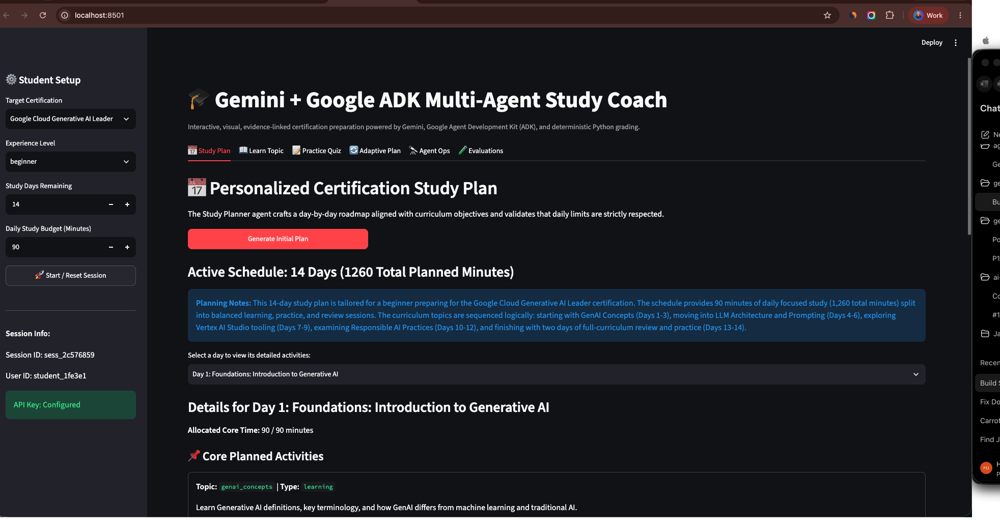
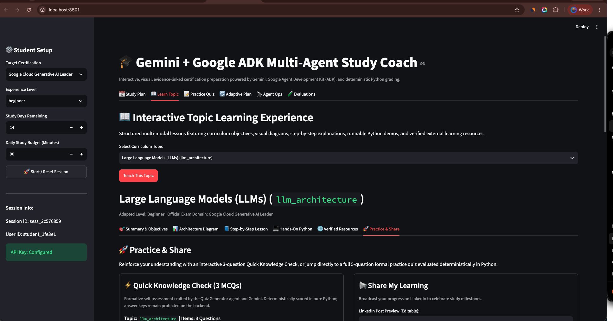
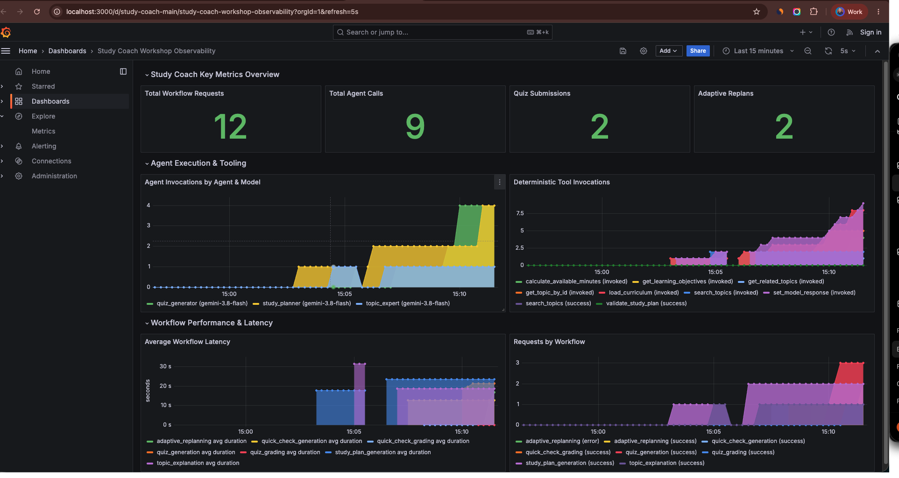
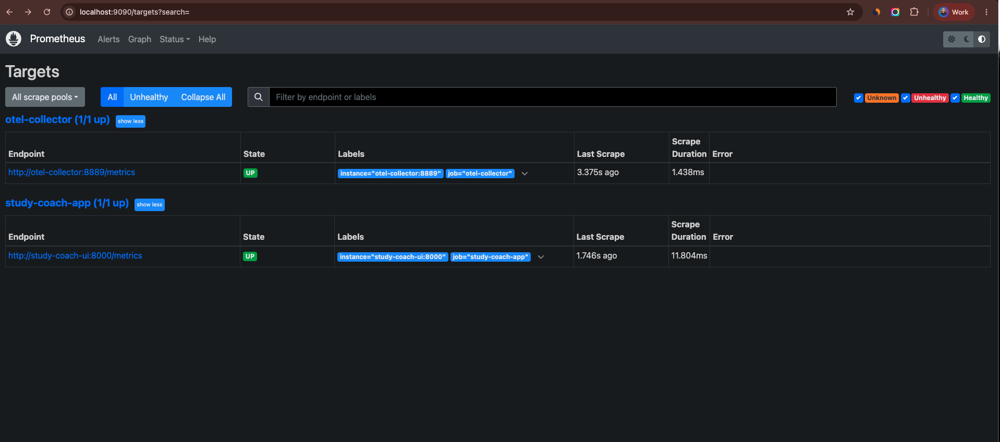
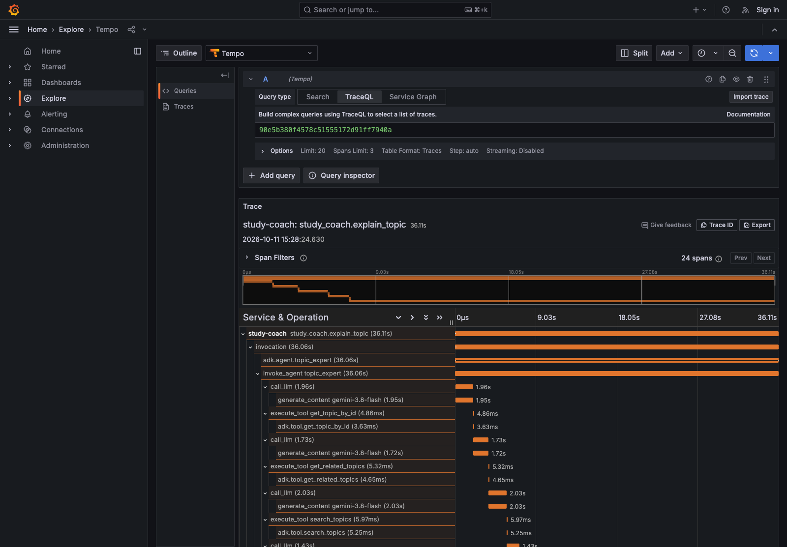

# AI Study Coach

## Project Overview
The AI Study Coach is a multi-agent application that helps students prepare for technical certifications. By providing your certification goal, time until the exam, and study availability, the coach will eventually be able to generate study plans, explain topics, and test your knowledge.

## Technology Stack
- **Language**: Python 3.12+
- **Framework**: Google ADK
- **LLM**: Gemini API
- **Data Validation**: Pydantic v2
- **Tooling**: uv, pytest, Ruff, mypy

## Architecture Diagram
See [Architecture Diagram](docs/architecture.md).

## Installation
1. Ensure you have `uv` installed.
2. Clone this repository.
3. Run `uv sync` to install dependencies.

## Gemini API Key Setup
You need a Gemini API key to run this application.
1. Go to [Google AI Studio](https://aistudio.google.com/).
2. Create an API key.
3. Copy `.env.example` to `.env`.
4. Update `GOOGLE_API_KEY` in your `.env` file with your key.

## Local Developer Lab Launch
To launch the unified Developer Lab Launcher GUI (default, port 8500), run:
```bash
./scripts/run_local.sh
```

From this launcher GUI (`http://localhost:8500`), you can access real-time status indicators and open:
1. **Google ADK Developer UI** (`http://127.0.0.1:8000`)
2. **Streamlit Study Coach** (`http://localhost:8501`)
3. **Streamlit Agent Ops Tab** (`http://localhost:8501/?tab=ops`)
4. **Streamlit Evaluations Tab** (`http://localhost:8501/?tab=eval`)
5. **Grafana Dashboard** (`http://localhost:3000`)
6. **Grafana Tempo Trace Explorer** (`http://localhost:3000/explore`)
7. **Prometheus Scraper & TSDB** (`http://localhost:9090`)

To launch only the standalone Google ADK Developer UI directly:
```bash
./scripts/run_local.sh --adk-only
```

## Example Conversation
- **Student:** I'm preparing for the Google Cloud Generative AI Leader certification in 14 days. I'm a beginner and can study 90 minutes daily.

- **Coach:** Welcome! I'm the AI Study Coach. I see you are aiming for the Google Cloud Generative AI Leader certification. In the future, I will be able to help you plan your studies, explain topics, and provide quizzes. Currently, these features are still in development!

## Running Tests
To run all tests and quality checks, use:
```bash
./scripts/run_tests.sh
```

To run the live Google ADK model evaluation suite:
```bash
uv run python tests/eval/run_live_evaluation.py
```

## Observability & Docker Deployment
The full observability stack (OpenTelemetry Collector, Grafana Tempo, Prometheus, and Grafana) is available under the Docker Compose `observability` profile:

```bash
# Build and launch all five services
docker compose --profile observability up -d --build

# Verify container statuses
docker compose --profile observability ps
```

- **Streamlit Web UI**: [http://localhost:8501](http://localhost:8501)
- **Prometheus Metrics**: [http://localhost:8000/metrics](http://localhost:8000/metrics)
- **Prometheus Dashboard**: [http://localhost:9090](http://localhost:9090)
- **Grafana Tempo (Traces)**: [http://localhost:3200](http://localhost:3200)
- **Grafana Dashboards**: [http://localhost:3000](http://localhost:3000) (pre-provisioned Study Coach dashboard)

For architecture diagrams, configuration details, and privacy redaction rules, see [Observability Guide](docs/observability.md) and [Evaluation Guide](docs/evaluation.md).

## Application Screenshots & Observability

The **Gemini + Google ADK Multi-Agent Study Coach** includes an interactive Streamlit learning experience, with observability through Grafana, Tempo and Prometheus.

### A. Personalized 14-Day Study Plan



The Study Planner creates a daily learning schedule with a defined time budget and curriculum-aligned activities.

### B. Interactive Topic Learning & Quick Checks



The Learn Topic experience includes explanations, verified resources, and a three-question formative MCQ flow, alongside learning-sharing controls.

### C. Grafana Observability Dashboard



The Grafana dashboard visualizes workflow requests, agent calls, quiz submissions, adaptive replanning, agent/tool activity, and latency. The screenshot shows recorded activity in a local development session; values will vary between runs.

### D. Prometheus Healthy Scrape Targets



Both the Study Coach application and OpenTelemetry Collector appear as **UP** in the Prometheus targets screen.

### E. Distributed Trace Waterfall in Grafana Tempo



This screenshot demonstrates actual OpenTelemetry distributed trace spans captured in Grafana Tempo during a live Google ADK Study Coach workflow (`explain_topic`).

The trace (`study-coach: study_coach.explain_topic`) visualizes 24 hierarchical spans and their measured durations across agent and tool lifecycles:
- **Workflow Root**: `study_coach.explain_topic` (36.11s) orchestrating the end-to-end request.
- **Agent Lifecycle**: `invocation`, `adk.agent.topic_expert`, and `invoke_agent topic_expert` (36.06s).
- **Gemini Model Calls**: `call_llm` and underlying `generate_content gemini-3.8-flash` spans measuring LLM inference latency.
- **Tool Executions**:
  - `get_topic_by_id` (`execute_tool` and `adk.tool.get_topic_by_id`) retrieving curriculum metadata.
  - `get_related_topics` (`execute_tool` and `adk.tool.get_related_topics`) discovering connected study topics.
  - `search_topics` (`execute_tool` and `adk.tool.search_topics`) querying topic definitions.
  - `set_model_response` (`execute_tool` and `adk.tool.set_model_response`) packaging structured agent outputs.

## Roadmap
- Milestone 1: Project Foundation (Done)
- Milestone 2: Study Planner Agent (Done)
- Milestone 3: Topic Expert Agent (Done)
- Milestone 4: Quiz Generator Agent (Done)
- Milestone 5: Multi-Agent Orchestration (Done)
- Milestone 6: Workshop UI & Docker (Done)
- Milestone 7: Observability and Evaluation (Done)
- Milestone 8: Workshop-Ready Release (Planned)

## Current Functionality vs Planned Features
- **Current**: 
  - Root coordinator agent (`study_coach`) routing student requests across all specialists.
  - **Study Planner Agent (`study_planner`)**: Generates structured, deterministic-checked study plans adhering to daily minute limits and curriculum topic IDs.
  - **Topic Expert Agent (`topic_expert`)**: Explains certification topics adapted to beginner, intermediate, and advanced levels, with Google Cloud examples, common misconceptions, and comprehension checks.
  - **Quiz Generator Agent (`quiz_generator`)**: Generates practice multiple-choice questions anchored in the curriculum, protects answer keys before submission, and grades student answers deterministically using Python.
  - **Adaptive Learning Orchestration Workflow (`AdaptiveStudyWorkflow`)**: Coordinates plan creation, topic learning, practice quiz generation, sanitized question presentation, deterministic scoring, and weak-topic prioritized replanning.
  - **Student Session State (`LearningSessionService`)**: In-memory session tracking powered by Google ADK `InMemorySessionService`.
  - **Student Workshop UI (`ui/app.py`)**: Multi-tab Streamlit web application providing study planning, topic learning, sanitized quizzing, grading, and adaptive replanning.
  - **Interactive Learning Experience & Practice**: Interactive 3-question formative Quick Knowledge Checks with `st.radio`, backend answer-key protection, pure Python deterministic scoring (100%, 66.7%, 33.3%, 0%), instant practice quiz navigation with topic preselection, enhanced LinkedIn post sharing draft with modern copy workflow, compact resource cards with authentic 28px vector provider brand logos across 19 technical platforms, privacy-safe sharing controls ([Open ↗], [Copy Link], and [Share ▾] popovers), responsive two-column grid, Mermaid architecture diagrams, and runnable Python examples.
  - **Docker & Docker Compose Runtime**: Hardened, reproducible containerization using pinned Python 3.12 slim, locked dependencies via `uv.lock`, healthchecks, and non-root execution.
  - **OpenTelemetry & Distributed Tracing**: Google ADK `ADKObservabilityPlugin` bridging agent and tool lifecycles to OpenTelemetry spans; high-level `@trace_workflow_step` timing decorators; Tempo distributed trace storage; API key sanitization (`[REDACTED_API_KEY]`) and answer-key masking.
  - **Prometheus Metrics & Grafana Dashboard**: Application Prometheus metrics endpoint on port 8000 with pre-initialized metric series; Grafana pre-provisioned datasource configuration; 11-panel Grafana dashboard (`study-coach-main`).
  - **Visual Agent Ops & Observability GUI**: Dedicated "🔭 Agent Ops" tab in Streamlit showing real-time Prometheus target health, container readiness, port mapping, and direct one-click launcher links to Grafana and Tempo trace explorer.
  - **Visual Agent Evaluations Dashboard**: Interactive "🧪 Evaluations" tab in Streamlit featuring a user-triggered evaluation runner, scenario list, pass/fail status metrics, per-scenario latency timings, expandable audit cards, error messaging, and sanitized JSON report persistence (`docs/reports/recent_evaluation_report.json`).
  - **Deterministic & Live Agent Evaluation**: 19 deterministic contract tests in `tests/eval/` and a live Google ADK model evaluation runner in `tests/eval/run_live_evaluation.py` evaluating topic explanation, quiz generation, study planning, and coordinator routing.
- **Planned**: Workshop-ready release package, distribution artifacts, and final verification.


