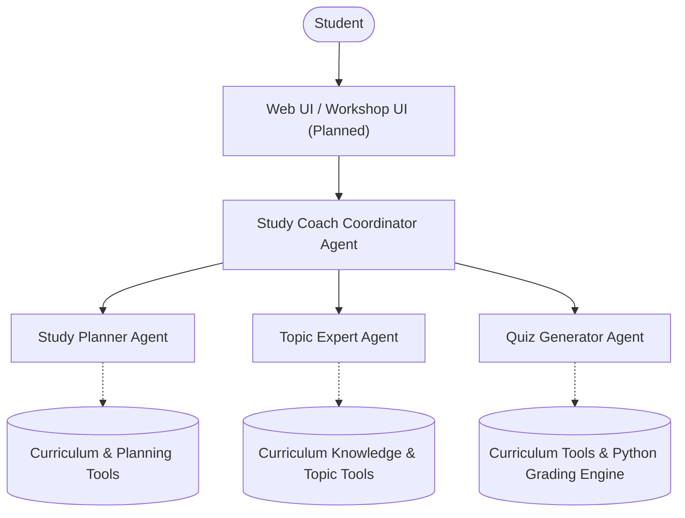

# Architecture

### Note on Features
The `Study Coach Coordinator Agent`, `Study Planner Agent`, `Topic Expert Agent`, `Quiz Generator Agent`, and `Adaptive Learning Multi-Agent Orchestration Workflow` are implemented as of Milestone 5. Session state management is powered by Google ADK `InMemorySessionService`, and answer grading and time-budget validation are 100% deterministic Python. Workshop containerization and telemetry are planned for future milestones.
