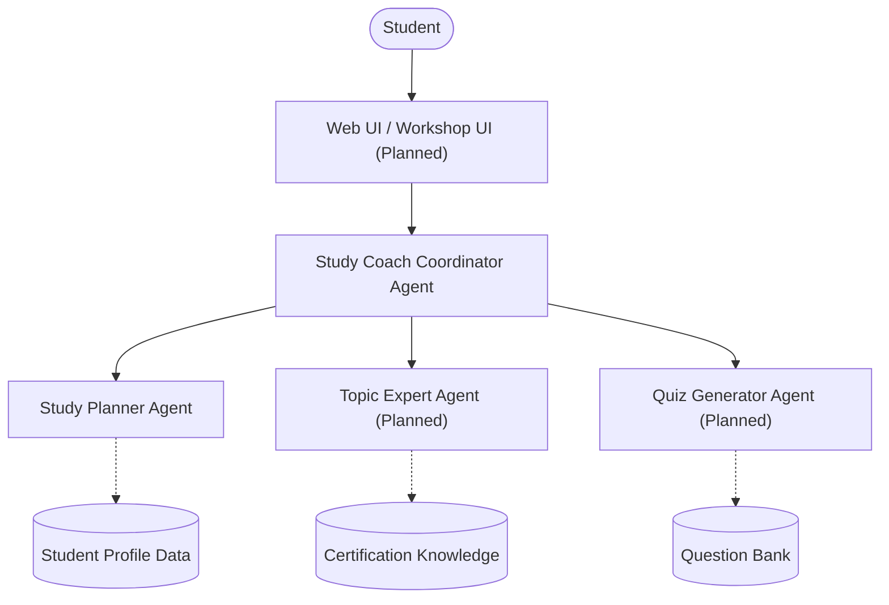

# Architecture

### Note on Features
The `Study Coach Coordinator Agent` and `Study Planner Agent` are currently implemented for Milestone 2. The web UI and other agents (`Topic Expert Agent`, `Quiz Generator Agent`) are planned for future milestones.
