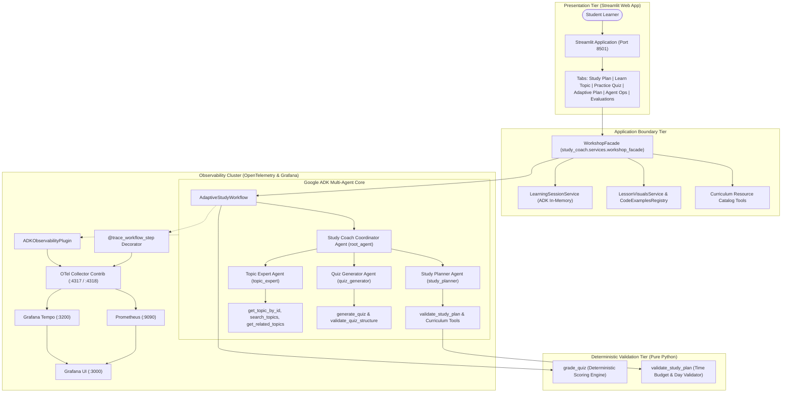
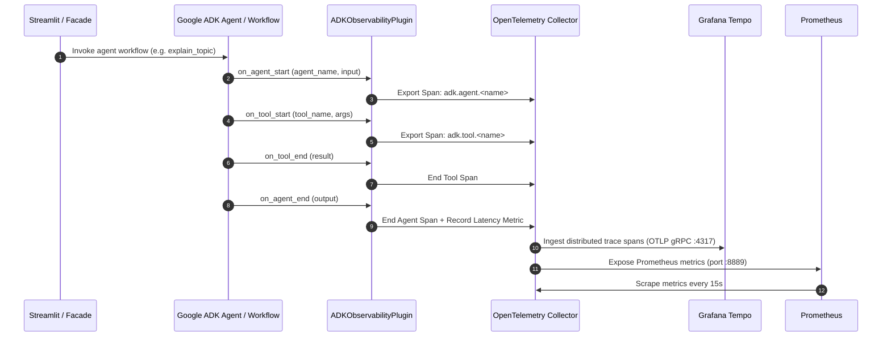

# System Architecture & Technical Specifications

This document outlines the software architecture, agent topology, data contracts, and telemetry flow for the **Gemini + Google ADK Multi-Agent Study Coach** (v1.0.0).

---

## 1. High-Level System Topology



---

## 2. Component Directory Structure

```text
src/study_coach/
├── agent.py                     # Root Coordinator Agent (ADK entrypoint)
├── agents/
│   ├── study_planner.py         # Study Planner specialist agent
│   ├── topic_expert.py          # Topic Expert specialist agent
│   └── quiz_generator.py        # Quiz Generator specialist agent
├── config.py                    # Environment and model configurations
├── data/
│   ├── curriculum.yaml          # Grounded certification syllabus
│   ├── learning_resources.yaml  # Curated resources with provider metadata
│   └── code_examples_registry.py# Curated, runnable Python examples
├── evaluation/
│   └── runner.py                # Reusable multi-agent evaluation runner
├── models/
│   ├── evaluation.py            # Evaluation summary and scenario models
│   ├── learning_session.py      # Session state and progress tracking models
│   ├── quiz.py                  # Quiz, question, submission, and result models
│   ├── student.py               # Student profile and constraint models
│   ├── study_plan.py            # Day and plan data models with validators
│   └── topic_explanation.py     # Structured topic explanation models
├── observability/
│   ├── decorators.py            # @trace_workflow_step telemetry wrappers
│   ├── metrics.py               # Prometheus counters, histograms, server
│   ├── plugin.py                # ADKObservabilityPlugin (ADK lifecycle to OTel)
│   ├── redaction.py             # Credential and answer-key masking utilities
│   └── tracing.py               # OpenTelemetry tracer provider setup
├── services/
│   ├── learning_session.py      # Session lifecycle service
│   ├── lesson_visuals.py        # Declarative Mermaid diagram service
│   └── workshop_facade.py       # Application service facade
├── tools/
│   ├── curriculum_tools.py      # Syllabus retrieval and search tools
│   ├── planning_tools.py        # Deterministic plan structure validators
│   ├── quiz_tools.py            # Deterministic Python grading engine
│   └── resource_tools.py        # Filtered learning resource lookup tools
└── workflows/
    └── adaptive_study.py        # Closed-loop adaptive orchestration workflow
```

---

## 3. Telemetry Pipeline Architecture



---

## 4. Security & Privacy Architecture

1. **Answer-Key Separation**: The `StudentQuizQuestion` model delivered to the browser contains only `question_id`, `topic_id`, `question_text`, `options`, and `difficulty`. The `correct_answer` and private `explanation` fields are kept server-side in `LearningSession.stored_quizzes`.
2. **Deterministic Grading**: When the student submits answers via `QuizSubmission`, grading is computed by `grade_quiz()` in pure Python, comparing chosen keys with server-side answers. LLMs are not used for scoring.
3. **Telemetry Redaction**: `study_coach.observability.redaction` inspects span attributes and metrics, redacting API keys (`[REDACTED_API_KEY]`) and stripping authorization headers.
4. **Environment Isolation**: API keys are loaded via `.env` or system environment variables; no credentials are hardcoded or committed to git.

---

## 5. Future Planned Architecture (Document RAG & Multi-Certification)

> **Notice**: As documented in `docs/roadmap.md`, Multi-Certification Management and Document RAG are post-v1.0.0 planned features. They do not exist in v1.0.0 and will be layered on top of the existing `WorkshopFacade` and `AdaptiveStudyWorkflow` without breaking baseline contracts.
