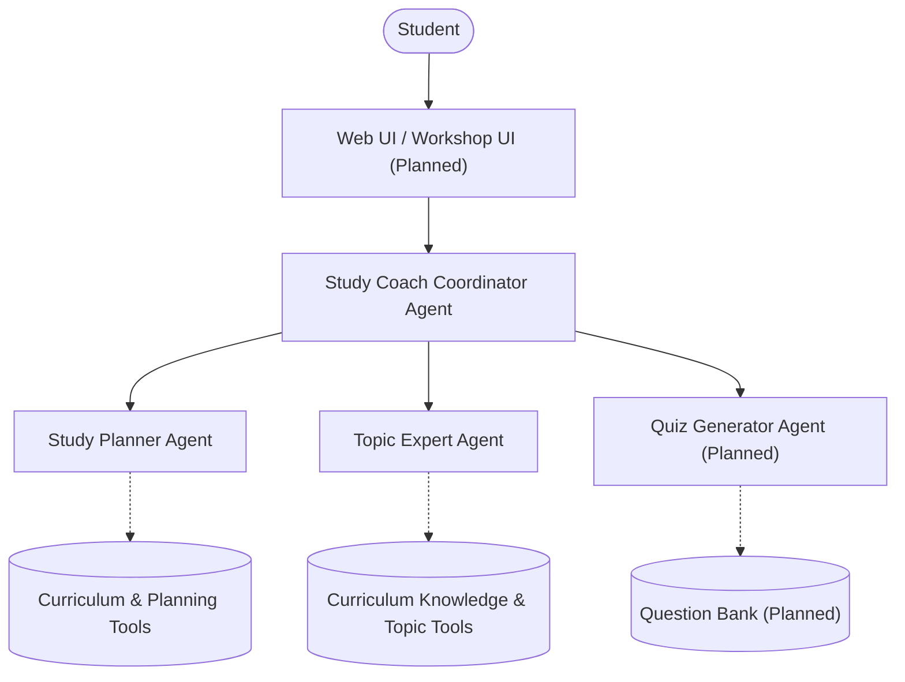

# Architecture

### Note on Features
The `Study Coach Coordinator Agent`, `Study Planner Agent`, and `Topic Expert Agent` are implemented as of Milestone 3. The web UI and `Quiz Generator Agent` are planned for future milestones.
