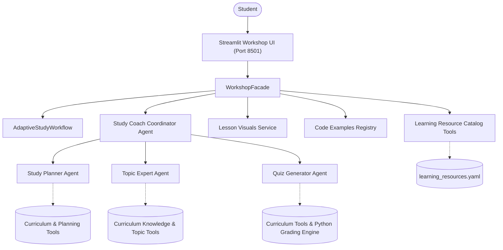

# Architecture

### Note on Features
The `Study Coach Coordinator Agent`, `Study Planner Agent`, `Topic Expert Agent`, `Quiz Generator Agent`, `Adaptive Learning Multi-Agent Orchestration Workflow`, `Streamlit Workshop Web UI`, `Interactive Learning Visuals`, `Curated Learning Resources Library`, `Runnable Python Examples`, and `Docker / Docker Compose Runtime` are implemented as of Milestone 6. Answer grading, resource filtering, and time-budget validations remain 100% deterministic Python. Telemetry, Prometheus, and Grafana are planned for Milestone 7.

