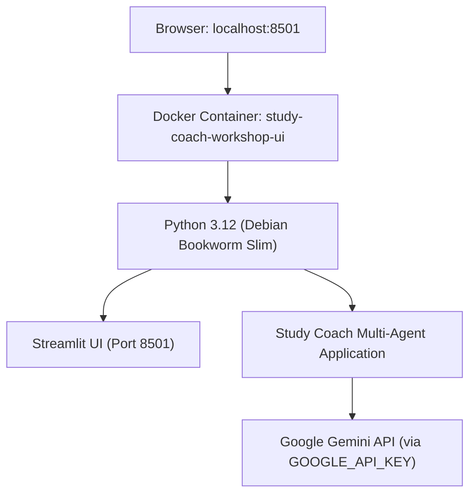

# Docker Deployment Guide

This guide covers building, configuring, and deploying the **Gemini ADK Study Coach Lab** using Docker and Docker Compose.

---

## 1. Container Architecture



- **Base Image**: `python:3.12-slim-bookworm` (Debian Bookworm minimal)
- **Dependency Manager**: Astral `uv` (locked dependencies from `uv.lock`)
- **Runtime User**: Non-root `appuser` (UID 1000) for security hardening
- **Exposed Port**: 8501 (Streamlit web interface)
- **Healthcheck**: Queries `http://localhost:8501/_stcore/health` every 15–30s

---

## 2. Dockerfile Configuration Details

The [`Dockerfile`](file:///Users/hastimal.jangid/Desktop/hmeb/GitHub/gemini-adk-study-coach-lab/Dockerfile) implements best practices for Python container builds:
1. **Multi-stage binary copy**: UV binaries copied from official `ghcr.io/astral-sh/uv` image.
2. **Deterministic lockfile export**: Generates non-editable, non-dev requirements from `uv.lock`.
3. **No baked secrets**: Credentials and `.env` files are excluded via `.dockerignore`.
4. **Non-root execution**: Runs under unprivileged `appuser`.
5. **Native health checking**: Uses `curl` to monitor the internal Streamlit core health status.

---

## 3. Docker Compose Usage

The [`docker-compose.yml`](file:///Users/hastimal.jangid/Desktop/hmeb/GitHub/gemini-adk-study-coach-lab/docker-compose.yml) coordinates environment variable injection and container lifecycle:

### Build and Start Container
```bash
# Start in foreground
docker compose up --build

# Or start in detached (background) mode
docker compose up --build -d
```

### Check Container Status
```bash
docker compose ps
```
Output:
```
NAME                      IMAGE                                       STATUS                    PORTS
study-coach-workshop-ui   gemini-adk-study-coach-lab-study-coach-ui   Up (healthy)   0.0.0.0:8501->8501/tcp
```

### Inspect Application Logs
```bash
docker compose logs -f --tail=100
```

### Stop and Clean Up
```bash
docker compose down
```

---

## 4. Platform-Specific Notes

### macOS (Apple Silicon / Intel)
- Docker Desktop automatically provides ARM64/AMD64 cross-compatibility.
- If using OrbStack, commands work identically.

### Windows (WSL 2)
- Ensure Docker Desktop is configured with WSL 2 backend.
- Place repository inside the WSL Linux filesystem (`/home/...`) for optimal volume performance.

### Linux (Ubuntu / Debian / Fedora)
- Ensure Docker Engine and Docker Compose V2 plugin (`docker compose`) are installed.
- Ensure the current user belongs to the `docker` group (`sudo usermod -aG docker $USER`).
