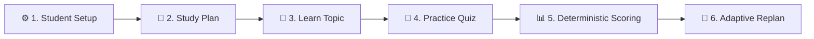

# Workshop Runbook & Participant Guide

This runbook guides GDG / DevFest workshop participants through setting up and running the **Gemini + Google ADK Multi-Agent Study Coach** application locally or via Docker.

---

## 1. Prerequisites

- **Python 3.12+** (if running natively)
- **uv** (recommended for Python package management: `curl -LsSf https://astral.sh/uv/install.sh | sh`)
- **Docker Desktop** (if running via containers on macOS, Windows, or Linux)
- **Google Gemini API Key** (obtainable free from [Google AI Studio](https://aistudio.google.com/))

---

## 2. API Key Configuration

1. Clone the repository:
   ```bash
   git clone https://github.com/hastimal/gemini-adk-study-coach-lab.git
   cd gemini-adk-study-coach-lab
   ```

2. Copy the example environment file:
   ```bash
   cp .env.example .env
   ```

3. Open `.env` and fill in your API key:
   ```env
   GOOGLE_API_KEY=your_actual_api_key_here
   GEMINI_MODEL=gemini-2.5-flash
   ```

---

## 3. Quickstart Options

### Option A: Running with Docker Compose (Recommended for Workshops)

Run the single command to build and launch the containerized application:

```bash
docker compose up --build
```

Then open your browser to:
👉 **http://localhost:8501**

To view logs or stop the container:
```bash
docker compose logs -f
docker compose down
```

---

### Option B: Native Development Setup

1. Install dependencies using locked versions:
   ```bash
   uv sync
   ```

2. Launch the Streamlit Student Workshop UI:
   ```bash
   uv run streamlit run ui/app.py
   ```
   Access at: 👉 **http://localhost:8501**

3. *(Optional)* Launch the ADK Developer UI separately:
   ```bash
   ./scripts/run_local.sh
   ```
   Access developer trace UI at: 👉 **http://localhost:8000**

---

## 4. End-to-End Learning Journey Walkthrough

The web UI provides four interconnected tabs reflecting the complete adaptive study loop:



1. **Student Setup (Sidebar)**:
   - Select certification (e.g. *Google Cloud Generative AI Leader*).
   - Choose experience level (*beginner*).
   - Set 14 days and 90 minutes daily budget.
   - Click **Start / Reset Session**.

2. **Tab 1: Study Plan**:
   - Click **Generate Initial Plan**.
   - Review day-by-day roadmap and verify daily minutes never exceed 90.
   - Select specific days (e.g., Day 4) to view **Curated Learning Resources** with verified links, badges, and separate duration estimates that preserve the core study budget.

3. **Tab 2: Learn Topic**:
   - Choose curriculum topic (e.g., `genai_concepts` or `llm_architecture`).
   - Click **Teach This Topic** to load 6 structured sub-tabs:
     - *🎯 Summary & Objectives*: Key concepts and objectives.
     - *📊 Architecture Diagram*: Interactive Mermaid architecture diagram with component breakdowns and accessible text alternatives.
     - *📘 Step-by-Step Lesson*: Detailed explanations and Google Cloud architectural examples.
     - *💻 Hands-On Python*: Self-contained, runnable Python code examples with expected outputs.
     - *🌐 Verified Resources*: Direct links to official Google documentation and free tutorials.
     - *🚀 Practice & Share*: Comprehension checks, one-click quiz jump, and LinkedIn share generator.

4. **Tab 3: Practice Quiz**:
   - Choose topic (or use preselected topic from Learn tab) and generate 5 multiple choice questions.
   - *Security Note*: Correct answers are hidden on the server until submission.
   - Choose options and click **Submit Answers for Deterministic Grading**.
   - Review exact score percentage and diagnostic weak topics ($< 70\%$).

5. **Tab 4: Adaptive Plan**:
   - Notice weak topics flagged from the quiz with **Recommended Remediation Pathways** (diagrams, code demos, official documentation).
   - Specify completed days (e.g. 3 days completed, 11 remaining).
   - Click **Generate Adapted Plan** to produce Revision 2, prioritizing remediation of weak topics within the remaining budget.


---

## 5. Troubleshooting Common Issues

| Issue | Cause | Solution |
| :--- | :--- | :--- |
| **"API Key: Not Found"** | Missing `.env` file | Ensure `.env` exists in the repository root and contains `GOOGLE_API_KEY=...`. |
| **Docker port conflict** | Port 8501 is occupied | Check running containers with `docker ps` or change port mapping in `docker-compose.yml` to `"8502:8501"`. |
| **Timeout during generation** | Rate limit or model latency | Allow 10–20 seconds for multi-turn structured generation. Retry using `gemini-2.5-flash`. |
| **Session reset unexpectedly** | Browser refreshed without storage | Streamlit maintains session state per browser tab; click **Start Session** to re-initialize. |
