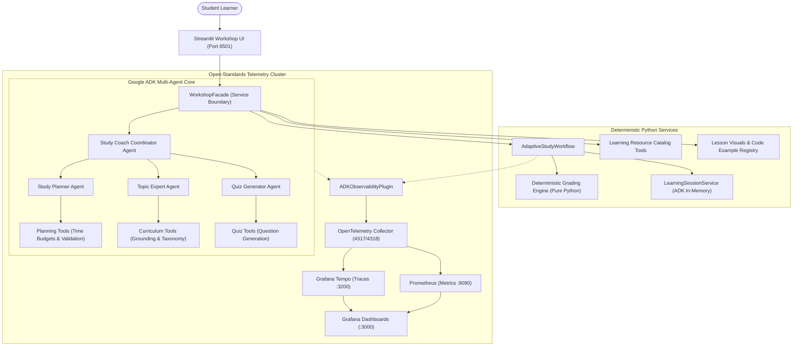
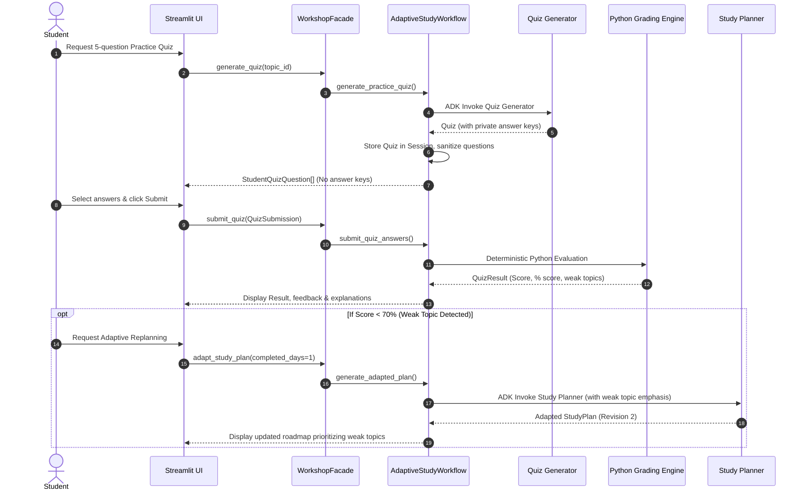

# Workshop Architecture Walkthrough

This document provides a guided walkthrough of the **Multi-Agent Study Coach** architecture, detailing how requests flow from user input through Google ADK agents, deterministic engines, and telemetry pipelines.

---

## 1. High-Level Multi-Agent Architecture

---

## 2. Specialized Agent Responsibilities

### 1. Root Coordinator Agent (`study_coach`)
- **Role**: Primary entrypoint routing requests across specialized agents.
- **Tools**: Sub-agent delegation tools (`invoke_agent`).
- **Guarantees**: Maintains conversation context and routes queries to the most qualified specialist.

### 2. Study Planner Agent (`study_planner`)
- **Role**: Generates day-by-day certification preparation schedules.
- **Constraints**:
  - Respects student daily study time limit (e.g. $\le 90$ minutes).
  - Produces sequential days matching exam deadline ($N$ days).
  - All topic IDs match validated curriculum entries.
- **Output**: Structured `StudyPlan` Pydantic model via `set_model_response`.

### 3. Topic Expert Agent (`topic_expert`)
- **Role**: Explains technical concepts grounded in the curriculum syllabus.
- **Pedagogical Structure**:
  - Structured learning objectives and core vocabulary.
  - In-depth conceptual explanation adapted to target level (*beginner*, *intermediate*, *advanced*).
  - Concrete Google Cloud architecture scenarios (e.g., Cymbal Retail with Vertex AI).
  - Common misconceptions and comprehension check questions.

### 4. Quiz Generator Agent (`quiz_generator`)
- **Role**: Creates multiple-choice questions assessing curriculum concepts.
- **Design**:
  - 4 distinct answer choices per question (`A`, `B`, `C`, `D`).
  - Answer keys and detailed explanations are stored exclusively server-side.
  - Sanitized student view (`StudentQuizQuestion`) is delivered to the frontend.

---

## 3. The Adaptive Closed Loop

---

## 4. Telemetry & Security Boundaries

1. **Answer Key Protection**: Ground-truth answers never enter client-side session state or HTML before submission.
2. **Credential Sanitization**: The OpenTelemetry instrumentation scrubs authorization headers, API keys, and sensitive student tokens (`[REDACTED_API_KEY]`).
3. **Deterministic Separation**: AI agents generate candidate content, but all scoring, time addition, and topic-existence checks run in deterministic Python code.
